# Từ dữ liệu NHANES đến mô hình KNN W0, W1 và W2

> **Mục đích:** tài liệu nền để viết báo cáo hoặc thuyết trình: dữ liệu lấy từ đâu, tại sao tạo bốn lớp, làm sạch và xử lý lệch dữ liệu như thế nào, từng phiên bản học gì, cải thiện bằng cách nào và còn giới hạn gì.
>
> **Ngày tổng hợp:** 31/10/2026. Số liệu lấy từ CSV/JSON và dự đoán đã lưu trong dự án, có đối chiếu mã nguồn. Lượt tổng hợp này **không huấn luyện lại** W0/W1/W2. Ảnh và bảng tái sử dụng nằm tại [`anh/`](anh/README.md); mỗi hình có PNG và SVG, mỗi bảng có thêm CSV.

## Mục lục

1. [Bài toán và cách đọc lịch sử thí nghiệm](#1-bài-toán-và-cách-đọc-lịch-sử-thí-nghiệm)
2. [Nguồn dữ liệu và cách xây cohort](#2-nguồn-dữ-liệu-và-cách-xây-cohort)
3. [Quy tắc tạo nhãn và lý do chọn bốn lớp](#3-quy-tắc-tạo-nhãn-và-lý-do-chọn-bốn-lớp)
4. [Các biến đầu vào và hình dạng dữ liệu](#4-các-biến-đầu-vào-và-hình-dạng-dữ-liệu)
5. [Làm sạch, dữ liệu thiếu và dữ liệu lệch](#5-làm-sạch-dữ-liệu-thiếu-và-dữ-liệu-lệch)
6. [Chuẩn bị train và đánh giá tránh rò rỉ](#6-chuẩn-bị-train-và-đánh-giá-tránh-rò-rỉ)
7. [W0: KNN với trọng số đều](#7-w0-knn-với-trọng-số-đều)
8. [W1 ban đầu: học trọng số MI](#8-w1-ban-đầu-học-trọng-số-mi)
9. [W1 cải thiện: hai trục và balanced voting](#9-w1-cải-thiện-hai-trục-và-balanced-voting)
10. [W2: cải thiện ngưỡng, K/alpha và trọng số nhóm](#10-w2-cải-thiện-ngưỡng-kalpha-và-trọng-số-nhóm)
11. [Kết luận có thể dùng trong báo cáo](#11-kết-luận-có-thể-dùng-trong-báo-cáo)
12. [Nguồn, hình và cách tái tạo](#12-nguồn-hình-và-cách-tái-tạo)

## 1. Bài toán và cách đọc lịch sử thí nghiệm

### 1.1. Mô hình dự đoán điều gì?

Đầu vào là các thông tin nhân khẩu, thể trạng, huyết áp, tiền sử, lối sống và một số xét nghiệm. Đầu ra là **một trong bốn pattern của hai chỉ số thận tại thời điểm khảo sát**:

- Không có dấu hiệu theo hai ngưỡng.
- Chỉ có albumin niệu.
- Chỉ có eGFR thấp.
- Có cả hai dấu hiệu.

“Bốn target” trong yêu cầu được hiểu là **bốn giá trị của một target đa lớp**, ký hiệu `target ∈ {0, 1, 2, 3}`. W1 hai trục và W2 học thêm hai nhãn nhị phân cấu thành target này, sau đó ghép dự đoán trở lại bốn lớp.

Đây là bài toán phân loại cắt ngang, không phải dự báo người nào sẽ mắc bệnh trong tương lai. Nhãn chỉ dựa trên một lần đo, không xác nhận bệnh thận mạn kéo dài và không phải bốn giai đoạn CKD. CDC cũng lưu ý các ước tính dựa trên một lần đo không phản ánh tính tồn tại dai dẳng của bất thường. [Nguồn: CDC, ghi chú phép đo một lần](https://www.cdc.gov/kidney-disease/media/pdfs/CKD-Factsheet-H.pdf).

### 1.2. Phân biệt bốn mốc để không so sánh sai

| Mốc thực nghiệm | Dữ liệu dùng phát triển/đánh giá | Feature | Cách làm chính | Nguồn kết quả |
|---|---|---:|---|---|
| W0 NHANES lịch sử | 2021–2023: 5.343 người; train 3.740, holdout 1.603 | 24 | Trọng số đều; chọn K trên train | `nhanes_w0_handoff/` |
| W1 ban đầu | Chỉ 3.740 người thuộc historical train | 24 | Một vector MI cho target bốn lớp; K=3 | `reports/w1/` |
| W1 cải thiện hai trục | Cohort kết hợp 13.086 người | 23 | Hai vector MI; cân bằng phiếu hàng xóm | `reports/combined_w1/` |
| W2 | Cùng 13.086 người, cùng outer splits của W1 hai trục | 23 | Ngưỡng chung, K/alpha, thử hệ số nhóm | `reports/w2/` |

**Quy tắc đọc kết quả:** không lấy macro-F1 holdout của W0 `0,2863` trừ trực tiếp cho macro-F1 repeated nested CV của W2 `0,4462` rồi kết luận thuật toán tăng `0,1599`. Các số đó khác dữ liệu, schema và cách đánh giá. Phép so sánh kiểm soát rõ nhất là A→B→C→D/E của W2, và các ablation W1 trên cùng cohort kết hợp.

File `KAGGLE_PHASE1_W0_BASELINE.md` là đặc tả **UCI CKD cũ**, không phải nguồn số liệu NHANES. Không dùng giả định UCI 400 mẫu, 24 biến và nhãn nhị phân để mô tả thực nghiệm hiện tại.

## 2. Nguồn dữ liệu và cách xây cohort

### 2.1. Dữ liệu gồm hai giai đoạn khảo sát

Nguồn là NHANES của CDC/NCHS:

- Giai đoạn 2017–March 2020: 15.560 người trong DEMO, giữ được 7.743 người đủ điều kiện mô hình.
- Giai đoạn August 2021–August 2023: 11.933 người trong DEMO, giữ được 5.343 người đủ điều kiện.
- Tổng kết hợp: **13.086 người**, với nhãn tính từ xét nghiệm có thật.

“2017–2023” là tên viết gọn của hai giai đoạn này; không có nghĩa dữ liệu bao phủ liên tục mọi thời điểm trong khoảng năm đó.

### 2.2. Ghép 13 module bằng khóa SEQN

| Module 2021–2023 | Nội dung | Vai trò trong dự án |
|---|---|---|
| `DEMO_L` | Nhân khẩu, kinh tế và thiết kế khảo sát | Bảng gốc, tuổi, giới, sắc tộc, học vấn, thu nhập |
| `BIOPRO_L` | Sinh hóa máu | Creatinine tạo nhãn eGFR; acid uric làm feature |
| `ALB_CR_L` | Albumin và creatinine nước tiểu | Tạo nhãn uACR |
| `BMX_L` | Đo cơ thể | BMI, vòng eo |
| `BPXO_L` | Huyết áp đo | Tính huyết áp trung bình |
| `BPQ_L` | Câu hỏi huyết áp/cholesterol | Tiền sử và dùng thuốc |
| `DIQ_L` | Câu hỏi đái tháo đường | Tiền sử đái tháo đường/tiền đái tháo đường |
| `SMQ_L` | Câu hỏi hút thuốc | Tạo biến hiện hút thuốc |
| `ALQ_L` | Câu hỏi rượu | Tiền sử, tần suất và lượng uống |
| `PAQ_L` | Câu hỏi hoạt động thể lực | Thời gian ngồi; hoạt động vừa ở schema lịch sử |
| `TCHOL_L` | Cholesterol toàn phần | Feature xét nghiệm |
| `HDL_L` | HDL cholesterol | Feature xét nghiệm |
| `CBC_L` | Công thức máu | Hemoglobin |

Chu kỳ cũ dùng các module tương ứng có tiền tố `P_`, ví dụ `P_DEMO`, `P_BIOPRO`, `P_ALB_CR`.

Các module có số dòng khác nhau vì điều kiện tham gia hoặc đo xét nghiệm khác nhau. Pipeline lấy DEMO làm bảng neo, ghép theo `SEQN`, kiểm tra khóa duy nhất trong từng module và báo lỗi nếu module có SEQN không thuộc DEMO. Nhờ vậy mỗi dòng cuối biểu diễn một người; không ghép theo thứ tự dòng và không dùng inner join toàn bộ module làm mất người chỉ vì thiếu một feature.

### 2.3. Điều kiện đưa vào supervised cohort

Một người được giữ khi:

```text
Tuổi ≥ 20
AND giới tính hợp lệ để tính eGFR
AND có creatinine máu LBXSCR
AND có albumin nước tiểu URXUMA
AND có creatinine nước tiểu URXUCR > 0
→ tính được eGFR, uACR và target
```

Mốc tuổi 20 là lựa chọn của nghiên cứu để giữ cohort người lớn và schema nhất quán; không phải khẳng định phương trình eGFR chỉ dùng được từ 20 tuổi.

| Chu kỳ | DEMO ban đầu | Vào cohort | Không vào cohort |
|---|---:|---:|---:|
| 2017–03/2020 | 15.560 | 7.743 | 7.817 |
| 08/2021–08/2023 | 11.933 | 5.343 | 6.590 |
| **Tổng** | **27.493** | **13.086** | **14.407** |

Trong chu kỳ mới, bảng master cho biết có 7.809 người từ 20 tuổi: 4.124 người bị loại do dưới 20 tuổi và 2.466 người lớn không đủ điều kiện tạo nhãn. Với chu kỳ cũ, manifest hiện có chỉ lưu số trước/sau; không tách chi tiết nguyên nhân loại trừ từng bước. Không gán toàn bộ 14.407 người ngoài cohort là “thiếu xét nghiệm”.

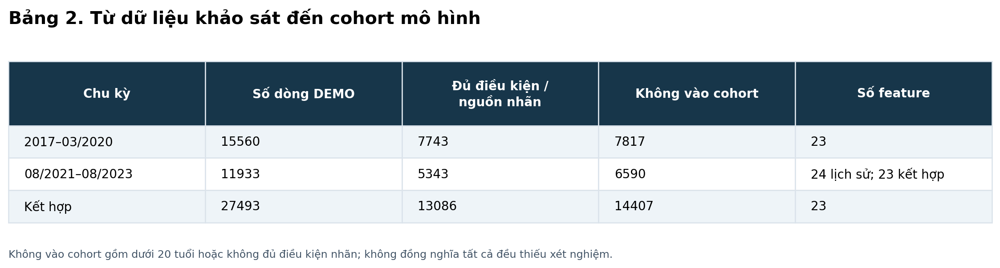

**Không điền khuyết nguồn tạo nhãn.** Nếu một người không có xét nghiệm cần thiết thì không tự điền creatinine/albumin để tạo nhãn cho người đó. Đây là điểm khác với việc điền khuyết các feature đầu vào.

### 2.4. Đồng nhất giữa hai chu kỳ trước khi gộp

**Albumin nước tiểu:** phương pháp đo mới dùng LC-MS/MS, khác phương pháp cũ. Theo phương trình bridge của CDC, pipeline chuyển albumin chu kỳ cũ sang thang mới:

```text
URXUMA_harmonized = 1.381 + 0.8407 × URXUMA_original
```

Sau đó mới tính uACR và target. Với chu kỳ mới, `URXUMA_harmonized = URXUMA_original`. Đây là đồng nhất phép đo, không phải tối ưu công thức để tăng điểm. [Nguồn: CDC ALB_CR_L, Analytic Notes](https://wwwn.cdc.gov/Nchs/Data/Nhanes/Public/2021/DataFiles/ALB_CR_L.htm).

**Thuốc huyết áp:** chu kỳ cũ dùng `BPQ050A`, chu kỳ mới dùng `BPQ150`. Pipeline đưa về cùng biến thể hiện hiện dùng thuốc, với skip logic từ `BPQ020/BPQ040A`. Chỉ suy ra “không dùng” khi đủ thông tin nhánh; các tình huống không xác định vẫn thiếu.

**Hoạt động thể lực:** loại `moderate_freq_week` khỏi phân tích kết hợp vì cách hỏi và đơn vị đo giữa hai chu kỳ không hoàn toàn tương đương. Do đó W0/W1 ban đầu có 24 feature, W1 hai trục/W2 có **23 feature**. Không âm thầm thêm lại biến này để gọi các schema là giống nhau.

## 3. Quy tắc tạo nhãn và lý do chọn bốn lớp

### 3.1. Tính eGFR

Mã nguồn dùng phương trình CKD-EPI creatinine 2021, với creatinine máu `SCr = LBXSCR` theo mg/dL:

```text
eGFR = 142 × min(SCr/κ, 1)^α × max(SCr/κ, 1)^(-1.200)
       × 0.9938^tuổi × (1.012 nếu nữ)

Nữ: κ = 0.7; α = -0.241
Nam: κ = 0.9; α = -0.302
```

Đơn vị eGFR là mL/phút/1,73 m². Phương trình này dùng tuổi, giới và creatinine; không dùng hệ số chủng tộc. Ký hiệu `α` trong phương trình sinh học này **khác** `alpha` dùng trộn trọng số MI ở phần mô hình. [Nguồn: NIDDK, eGFR Equations for Adults](https://www.niddk.nih.gov/research-funding/research-programs/kidney-clinical-research-epidemiology/laboratory/glomerular-filtration-rate-equations/adults).

### 3.2. Tính uACR

```text
uACR (mg/g) = albumin nước tiểu (µg/mL) / creatinine nước tiểu (mg/dL) × 100
```

Dùng `URXUMA_harmonized` cho cohort kết hợp. Hệ số 100 là quy đổi đơn vị, không phải siêu tham số mô hình. Tỷ số này thể hiện albumin theo lượng creatinine niệu, thay vì lấy riêng nồng độ albumin phụ thuộc độ cô đặc nước tiểu.

### 3.3. Hai rule nhị phân → một target bốn lớp

```python
G = int(eGFR < 60)
A = int(uACR >= 30)
target = A + 2 * G
```

| Target | eGFR | uACR | G | A | Diễn giải |
|---:|---|---|---:|---:|---|
| 0 | ≥60 | <30 | 0 | 0 | Không có dấu hiệu theo hai ngưỡng |
| 1 | ≥60 | ≥30 | 0 | 1 | Chỉ có albumin niệu |
| 2 | <60 | <30 | 1 | 0 | Chỉ có eGFR thấp |
| 3 | <60 | ≥30 | 1 | 1 | Có cả hai dấu hiệu |

Quy tắc biên được xác định rõ: **eGFR đúng 60 không được coi là thấp; uACR đúng 30 được coi là cao**. Hai ngưỡng tương ứng các dấu hiệu chức năng lọc và albumin niệu được dùng trong tài liệu xét nghiệm thận. [Nguồn: CDC, Testing for Chronic Kidney Disease](https://www.cdc.gov/kidney-disease/testing/index.html).

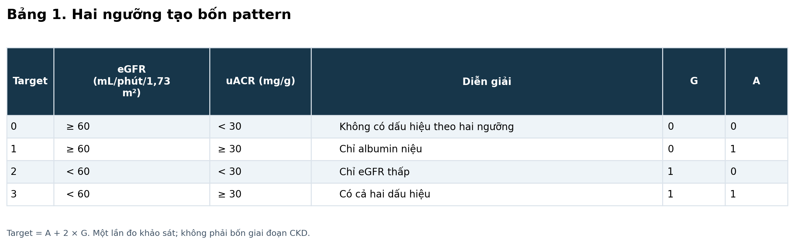

### 3.4. Tại sao chọn bốn lớp?

1. **Giữ hai kiểu dấu hiệu khác nhau.** Nếu gộp lớp 1, 2, 3 thành một nhãn dương, mô hình không còn phân biệt albumin niệu đơn độc với giảm eGFR đơn độc hoặc đồng thời cả hai.
2. **Bao phủ đủ tổ hợp của hai điều kiện nhị phân.** Hai trục có 2×2=4 trạng thái; cách mã hóa rõ ràng và kiểm tra lại được từ số đo.
3. **Phù hợp thiết kế W1 hai trục.** Mỗi trục có thể có tập feature liên quan khác nhau, nhưng đầu ra vẫn trả về cùng bốn pattern.
4. **Kiểm tra khả năng nhận diện nhóm hiếm.** Lớp 3 ít người nhất nên accuracy tổng không đủ để biết mô hình có nhận ra nhóm này hay không.

Đây là lý do thiết kế bài toán, không phải bằng chứng bốn lớp là cách chia tối ưu cho mọi mục tiêu. Cách chia làm số mẫu lớp 3 ít và bài toán khó hơn. Lớp 0 cũng không có nghĩa “chắc chắn không có bất kỳ bệnh thận nào”; nó chỉ không vượt hai ngưỡng đang dùng.

## 4. Các biến đầu vào và hình dạng dữ liệu

### 4.1. Tách bảng lưu trữ và ma trận đưa vào model

File kết hợp có **13.086 dòng và 38 cột lưu trữ**. Ma trận đầu vào chỉ lấy đúng 23 feature theo manifest:

```text
X: 13.086 × 23
y: 13.086 giá trị thuộc {0,1,2,3}
y_G: 13.086 giá trị thuộc {0,1}
y_A: 13.086 giá trị thuộc {0,1}
```

Các cột bổ sung dùng để nhận diện người, phân biệt chu kỳ, kiểm tra nhãn và lưu thiết kế khảo sát. Không truyền toàn bộ bảng 38 cột vào KNN.

| Loại cột | Ví dụ | Có dùng trong X? | Lý do |
|---|---|---|---|
| Feature | Tuổi, BMI, huyết áp, tiền sử, HDL, acid uric | Có | Dùng để tính khoảng cách |
| Định danh | `row_id`, `SEQN` | Không | Chỉ ghép và đối chiếu |
| Chu kỳ | `cycle` | Không | Dùng phân tích/temporal split |
| Nguồn nhãn | `LBXSCR`, albumin niệu, `URXUCR` | Không | Tránh đưa trực tiếp công thức tạo nhãn vào đầu vào |
| Nhãn dẫn xuất | `egfr_2021_ckdepi`, `uacr_mg_g`, `egfr_low`, `uacr_high`, `target` | Không | Đây là kết quả cần dự đoán |
| Thiết kế khảo sát | `survey_exam_weight`, `SDMVSTRA`, `SDMVPSU` | Không | Lưu để phân tích khảo sát riêng; chưa dùng trong thí nghiệm hiện tại |

Tuổi và giới được giữ làm feature dù cũng tham gia phương trình eGFR. Vì vậy sự liên quan của tuổi với nhãn có một phần do định nghĩa nhãn; không diễn giải trọng số tuổi thành bằng chứng nhân quả độc lập.

### 4.2. Bộ 23 feature

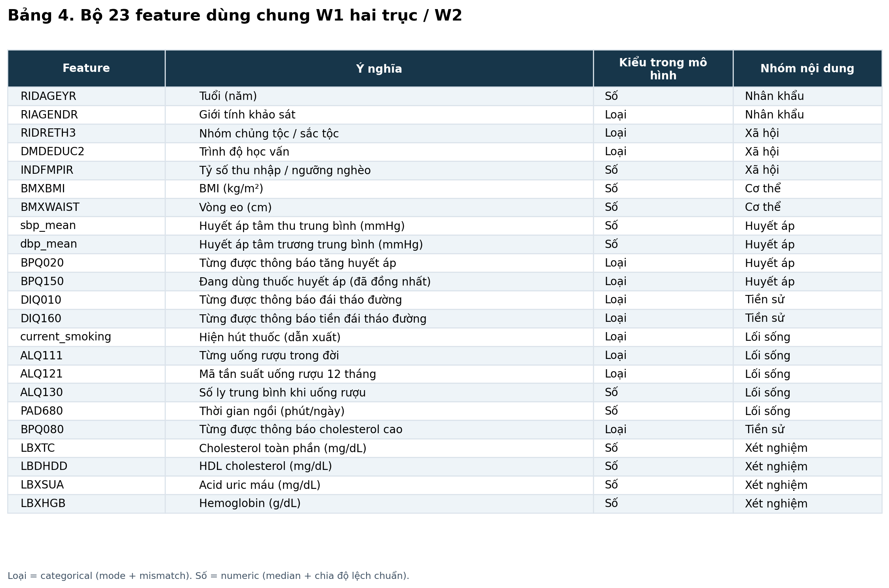

Danh sách theo đúng thứ tự dùng trong file/manifest:

```text
RIDAGEYR, RIAGENDR, RIDRETH3, DMDEDUC2, INDFMPIR,
BMXBMI, BMXWAIST, sbp_mean, dbp_mean,
BPQ020, BPQ150, DIQ010, DIQ160, current_smoking,
ALQ111, ALQ121, ALQ130, PAD680, BPQ080,
LBXTC, LBDHDD, LBXSUA, LBXHGB
```

Có **12 biến số và 11 biến phân loại**. Không suy kiểu biến chỉ từ dtype: ví dụ `ALQ121` chứa các số mã hóa 0–10 nhưng pipeline xử lý như biến phân loại, không giả định khoảng cách giữa các mã là khoảng cách tần suất thực.

Các nhóm nội dung giúp giải thích vì sao đưa feature vào: bối cảnh nhân khẩu/xã hội, thể trạng, huyết áp, tiền sử chuyển hóa, hành vi và xét nghiệm. Đây là schema thiết kế của dự án, chưa phải kết quả một thí nghiệm chứng minh cả 23 biến đều cần thiết.

### 4.3. Bảng ví dụ các dòng thật

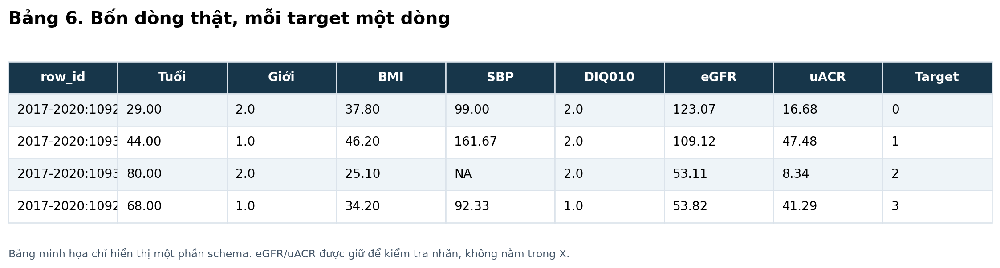

Bảng chọn dòng đầu tiên của từng lớp từ CSV hiện có, không tạo người giả. Chỉ hiển thị một phần schema; `eGFR/uACR` xuất hiện để giải thích target, không được dùng trong X. Dữ liệu còn có thể thiếu feature trước khi vào pipeline; “modeling complete” trong tên file lịch sử nghĩa là đủ điều kiện/nguồn nhãn, không phải mọi feature đã đầy đủ.

## 5. Làm sạch, dữ liệu thiếu và dữ liệu lệch

### 5.1. Ba vấn đề “lệch” cần xử lý khác nhau

| Vấn đề | Hiện tượng trong dự án | Cách xử lý đã áp dụng |
|---|---|---|
| Lệch lớp | Lớp 0 rất đông, lớp 3 rất ít | Stratified split; macro-F1; balanced voting ở W1 cải thiện/W2 |
| Khác đơn vị và phân bố feature | Tuổi, BMI, tiền, thời gian ngồi có thang đo khác nhau | Numeric chia theo độ lệch chuẩn train; categorical dùng mismatch |
| Khác chu kỳ/phép đo | Albumin và cách hỏi khác nhau | Bridge albumin; đồng nhất thuốc; bỏ biến hoạt động không tương đương; temporal validation |

Scale không làm các lớp cân bằng. Balanced voting cũng không sửa được sai khác phương pháp xét nghiệm. Do đó phải xử lý các vấn đề này ở các bước riêng.

### 5.2. Lệch lớp nặng đến mức nào?

| Target | 2017–2020 | 2021–2023 | Tổng kết hợp | Tỷ lệ kết hợp |
|---:|---:|---:|---:|---:|
| 0 | 6.368 | 4.418 | 10.786 | 82,42% |
| 1 | 757 | 471 | 1.228 | 9,38% |
| 2 | 382 | 311 | 693 | 5,30% |
| 3 | 236 | 143 | 379 | 2,90% |
| **Tổng** | **7.743** | **5.343** | **13.086** | **100%** |

Lớp 0 đông khoảng **28,5 lần** lớp 3. Mô hình luôn đoán lớp 0 sẽ đạt accuracy `82,42%`, nhưng balanced accuracy chỉ `0,25` và macro-F1 khoảng `0,2259` trên cohort kết hợp. Đây là ví dụ tính từ phân bố lớp để giải thích metric, không phải một mô hình bổ sung đã train.

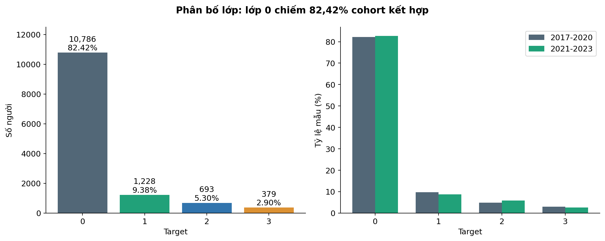

Pipeline **không dùng SMOTE, oversampling hay undersampling** trong các kết quả này. W1 cải thiện/W2 thay đổi sức nặng phiếu của hàng xóm thay vì sinh thêm bản ghi. Lợi ích là giữ nguyên dữ liệu đo thật; chi phí là có thể tăng dự đoán dương giả, cần kiểm soát bằng ngưỡng.

Các tỷ lệ trên là tỷ lệ trong mẫu phân tích, chưa áp dụng survey weights; không gọi là tỷ lệ bệnh trong toàn dân Hoa Kỳ.

### 5.3. Làm sạch cấu trúc và mã dữ liệu

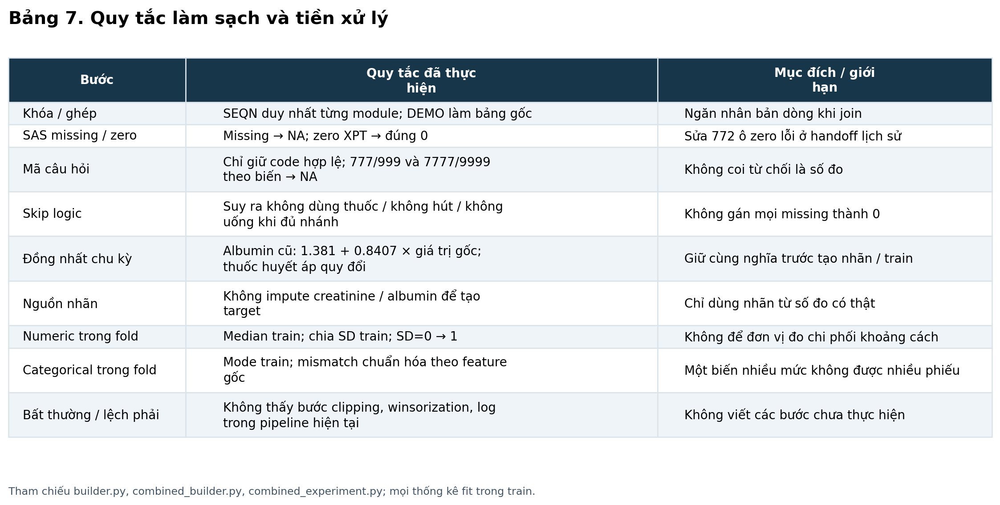

Các quy tắc cụ thể đã có trong mã nguồn:

1. **Kiểm tra khóa:** một SEQN chỉ xuất hiện một lần mỗi module; khi kết hợp thêm `row_id = cycle:SEQN` để đối chiếu duy nhất.
2. **Đọc XPT đúng missing/zero:** SAS missing được giữ là thiếu. Sửa lỗi parser lịch sử biểu diễn zero thành `5.397605346934028e-79`. Manifest ghi nhận **772 ô** thuộc `ALQ121` (728), `INDFMPIR` (41), `PAD680` (3) ở handoff lịch sử; đây là số ô, không phải 772 người.
3. **Mã từ chối/không biết:** chỉ giữ code hợp lệ theo biến. Ví dụ `ALQ130` có 777/999 → thiếu; `PAD680` có 7777/9999 → thiếu. Không thay mọi số 7 hoặc 9 trong mọi biến bằng NA.
4. **Huyết áp trung bình:** lấy trung bình các lần đo 1–3 có sẵn; thiếu cả ba mới để thiếu.
5. **Hút thuốc:** dùng `SMQ020/SMQ040` để suy ra hiện hút hay không; trường hợp không xác định vẫn thiếu.
6. **Rượu và skip logic:** chỉ suy ra tần suất 0 khi nhánh trả lời chứng minh chưa uống; số ly được suy ra 0 theo điều kiện trong builder. Không coi tất cả ô trống là “không uống”.
7. **Thuốc huyết áp:** suy ra không dùng thuốc khi nhánh câu hỏi cho phép; còn lại giữ thiếu.
8. **Nguồn nhãn:** giữ số đo có thật, đồng nhất albumin trước khi áp ngưỡng, không tạo pseudo-label.

Với schema lịch sử, `moderate_freq_week` được quy đổi đơn vị sang tuần; lượng dương nhưng thiếu đơn vị không được tự coi bằng 0. Biến này không nằm trong phân tích kết hợp 23 feature.

### 5.4. Dữ liệu thiếu được xử lý như thế nào?

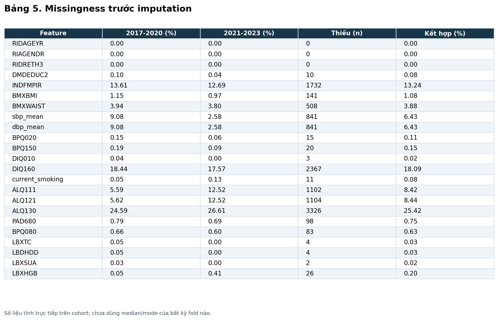

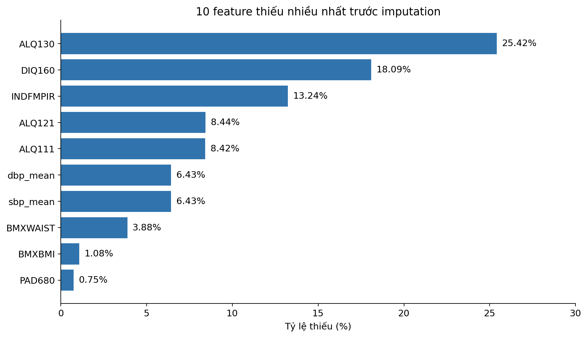

Trong 13.086 người có nhãn, **6.320 người (48,30%) thiếu ít nhất một feature**, chỉ 6.766 người đầy đủ cả 23 feature; tổng cộng 12.238 ô feature thiếu. Nếu xóa mọi dòng thiếu feature, gần một nửa cohort sẽ bị mất. Các tỷ lệ thiếu cao nhất là `ALQ130` 25,42%, `DIQ160` 18,09%, `INDFMPIR` 13,24%; bảng trên lưu đầy đủ theo từng chu kỳ.

Giá trị thiếu vẫn được lưu trong CSV. **Chỉ khi train một fold**, pipeline mới:

- Với biến số: tính median trên train của fold, dùng median đó điền cho train/validation, rồi chia theo độ lệch chuẩn của train sau điền.
- Với biến phân loại: tính mode trên train của fold, dùng cùng mode để điền validation.
- Nếu độ lệch chuẩn bằng 0 hoặc không hữu hạn, dùng scale=1 để tránh chia cho 0.

Mã hiện tại căn giữa numeric theo **median**, rồi chia SD; vì cùng trừ một hằng số nên khoảng cách giữa hai giá trị sau xử lý vẫn là chênh lệch chia SD. Không mô tả nhầm implementation này là gọi trực tiếp `StandardScaler` căn giữa theo mean.

Những biến thiếu đáng chú ý ở cohort kết hợp gồm `ALQ130`, `DIQ160`, `INDFMPIR`, `ALQ111/ALQ121`, huyết áp và vòng eo. Một phần missing có thể liên quan skip logic hoặc không tham gia phần đo, không mặc định missing hoàn toàn ngẫu nhiên. Imputation giúp giữ người có nhãn, nhưng không tự giải quyết selection bias hay mọi sai lệch do missingness.

### 5.5. Ngoại lệ và phân bố lệch phải

Pipeline đã chuẩn hóa thang đo nhưng **không có bước log-transform, clipping hoặc winsorization feature** trong thí nghiệm hiện tại. Do đó không viết “đã loại hết outlier” hoặc “đã đưa mọi biến về phân phối chuẩn”. Giá trị lớn vẫn có thể ảnh hưởng mạnh đến khoảng cách Euclidean; đây là giới hạn còn lại.

Nếu thử robust scaling, log-transform hoặc cắt ngưỡng trong tương lai, phải coi đó là ablation mới và học các ngưỡng từ train fold. Không sửa dữ liệu gốc rồi gán điểm W1/W2 đã lưu cho pipeline mới.

## 6. Chuẩn bị train và đánh giá tránh rò rỉ

### 6.1. Khoảng cách theo feature gốc

Với p feature:

```text
d_w(x, z)² = Σ_j w_j × D_j(x_j, z_j)
w_j ≥ 0; Σ_j w_j = 1

Numeric:     D_j = ((x_j đã điền - z_j đã điền) / SD_train_j)²
Categorical: D_j = 0 nếu giống; 1 nếu khác
```

Nếu categorical dùng one-hot, một mismatch tạo tổng bình phương chênh lệch bằng 2. Pipeline nhân nhóm one-hot với `sqrt(w_j/2)` để toàn bộ một biến categorical chỉ đóng góp đúng `w_j`, bất kể biến đó có bao nhiêu mức. Không chia đều trọng số cho từng cột one-hot rồi làm biến nhiều mức có ảnh hưởng lớn hơn.

KNN không học hệ số bằng gradient như mạng neural. “Train KNN” ở đây gồm fit imputer/scale, ước lượng MI nếu có, chọn K/ngưỡng/hệ số nhóm qua CV, rồi lưu các điểm train đã biến đổi để tìm hàng xóm. Khi dự đoán, mô hình tìm các điểm gần nhất trong tập tham chiếu train và tổng hợp phiếu của họ.

### 6.2. Vì sao cần nested CV?

```text
Dữ liệu đủ nhãn
  └── Outer split: tách outer-train và outer-test
       ├── Inner CV chỉ trong outer-train
       │    ├── fit median/mode/scale và MI trên inner-train
       │    ├── dự đoán inner-validation
       │    └── chọn alpha, K, threshold, candidate theo protocol
       ├── refit pipeline với tham số đã chọn trên outer-train
       └── đánh giá đúng một lần trên outer-test
```

Inner CV chọn cấu hình; outer-test ước lượng hiệu quả của quy trình chọn đó. Nếu tính MI, median hay threshold từ cả cohort trước khi chia fold thì outer-test đã ảnh hưởng đến mô hình, làm kết quả lạc quan.

W1 hai trục/W2 dùng **outer 5 folds × 5 repeats, inner 3 folds**, stratify theo target bốn lớp. Có 25 outer evaluations cho mỗi cấu hình; mỗi người có một dự đoán OOF trong mỗi repeat. Tổng OOF của một cấu hình là `13.086 × 5 = 65.430 lượt dự đoán`, không phải 65.430 người độc lập.

### 6.3. Metric chính và cách đọc

| Metric | Đo điều gì? | Tại sao cần? |
|---|---|---|
| Accuracy | Tỷ lệ phân loại đúng trên tất cả người | Dễ hiểu nhưng bị chi phối bởi lớp 0 |
| Precision lớp c | Trong những người dự đoán c, bao nhiêu đúng c? | Cho biết mức độ báo động nhầm |
| Recall lớp c | Trong những người thật sự là c, bao nhiêu được nhận đúng? | Cho biết mức độ bỏ sót |
| F1 lớp c | Trung bình điều hòa precision và recall | Cần cả hai mặt tốt |
| **Macro-F1** | Trung bình F1 của bốn lớp với trọng số bằng nhau | **Metric chọn chính**, không cho lớp 0 lấn át |
| Balanced accuracy | Trung bình recall bốn lớp | Đọc khả năng nhận đúng từng nhóm |
| AP từng trục | Tổng hợp precision–recall khi thay đổi threshold | Phân biệt chất lượng xếp hạng với một ngưỡng quyết định |
| FP từ lớp 0 / 1.000 | Người thật lớp 0 nhưng dự đoán 1/2/3, chia tổng người đánh giá ×1.000 | Lượng hóa chi phí báo động nhầm |

**Phân biệt cách gộp:** trung bình macro-F1 qua 25 fold không nhất thiết bằng macro-F1 tính từ confusion matrix OOF gộp, vì F1 là hàm phi tuyến. Tài liệu dùng mean outer-fold cho bảng so sánh chính; confusion matrix ghi rõ là OOF gộp.

Các dấu `±` trong bảng W1/W2 là **độ lệch chuẩn giữa outer folds**, không phải sai số chuẩn. Những khoảng 95% từ chênh lệch repeat chỉ dùng mô tả; tập train chồng lấn nên không coi các fold/repeat là nghiên cứu độc lập.

## 7. W0: KNN với trọng số đều

### 7.1. W0 được train như thế nào?

W0 dùng cohort NHANES 2021–2023 gồm 5.343 người, 24 feature và target bốn lớp. Split lịch sử stratified 70/30, seed=42:

| Tập | Target 0 | Target 1 | Target 2 | Target 3 | Tổng |
|---|---:|---:|---:|---:|---:|
| Train | 3.092 | 330 | 218 | 100 | 3.740 |
| Holdout đã xem | 1.326 | 141 | 93 | 43 | 1.603 |

Trọng số ban đầu cố định:

```text
W0 = (1/24, 1/24, ..., 1/24)
Mỗi feature gốc có weight ≈ 0,041667.
```

W0 không “học ra” các trọng số này. Phần chọn tham số là chọn K qua 5-fold CV trên train, dùng macro-F1. File `cv_m1.csv` lưu lưới K thực tế `{3,5,7,9,11,15,21}`; K tốt nhất là **3**. M1 dùng phiếu đồng đều của hàng xóm; M2 giữ feature đều nhưng đổi sang distance voting.

Quy trình khái niệm: tách train/holdout → fit preprocessing trong CV train → chọn K → fit toàn bộ train → dự đoán holdout. Handoff hiện có schema, trọng số, bảng CV, train/holdout và metrics, nhưng không có notebook/pipeline W0 đã fit để kiểm tra đầy đủ mọi chi tiết preprocessing lịch sử. Vì vậy các kết quả dưới đây được gọi là **baseline lịch sử đã lưu**; không khẳng định đã chạy tái lập đầy đủ W0 trong lượt viết tài liệu này.

### 7.2. W0 đạt kết quả gì?

| Cấu hình | K | CV chọn K: macro-F1 | Holdout accuracy | Holdout macro-F1 | Holdout balanced accuracy | Holdout recall 3 |
|---|---:|---:|---:|---:|---:|---:|
| M1: W0 + uniform vote | 3 | 0,3155 | 0,8104 | 0,2863 | 0,2825 | 0,0233 |
| M2: feature đều + distance vote | 3 | 0,3399 | 0,7948 | 0,2981 | 0,2932 | 0,0698 |

Accuracy được tính lại từ confusion matrix trong `baseline_metrics.json`. Cột CV chọn K là kết quả dùng trong lựa chọn K, khác với outer-CV của W1 ban đầu.

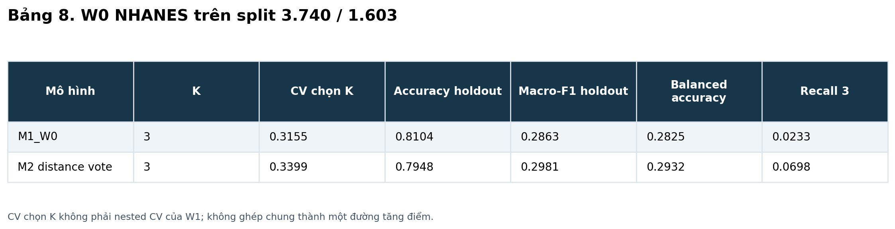

Confusion matrix M1, hàng là thật, cột là dự đoán:

| True \ Pred | 0 | 1 | 2 | 3 |
|---|---:|---:|---:|---:|
| 0 | 1.283 | 25 | 16 | 2 |
| 1 | 128 | 6 | 7 | 0 |
| 2 | 75 | 3 | 9 | 6 |
| 3 | 30 | 6 | 6 | 1 |

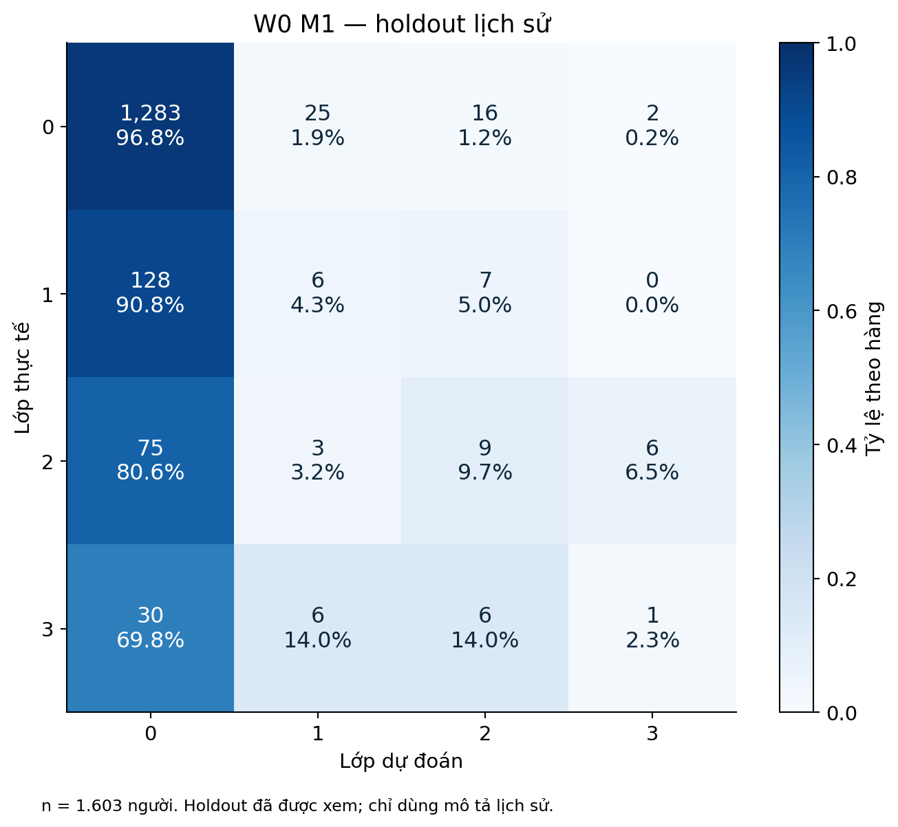

W0 nhận đúng **1/43** người lớp 3, nhưng đúng **1.283/1.326** người lớp 0. Vậy accuracy khoảng 81% không chứng minh mô hình làm tốt bốn lớp. Confusion matrix cho thấy xu hướng dự đoán lớp 0. Một giả thuyết giải thích là lớp 0 chiếm phần lớn lân cận, trong khi trọng số đều chưa ưu tiên được tín hiệu phân biệt nhóm hiếm; riêng matrix chưa chứng minh nguyên nhân này.

### 7.3. Distance voting giúp được gì?

Thay vì mỗi hàng xóm một phiếu như nhau, M2 dùng phiếu tỷ lệ nghịch khoảng cách, để người gần hơn ảnh hưởng mạnh hơn. Macro-F1 holdout tăng từ `0,2863` lên `0,2981`; nhận đúng lớp 3 tăng từ 1 lên 3 người. Accuracy giảm từ khoảng `0,8104` còn `0,7948`.

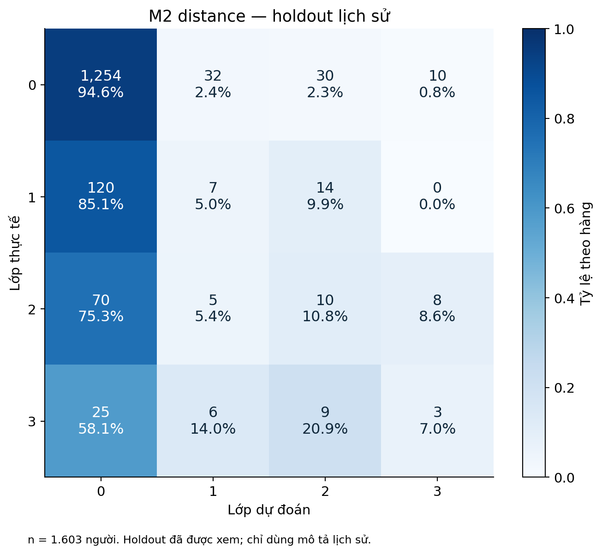

Đây là cải thiện nhỏ về phân biệt nhóm thiểu số, chưa giải quyết lệch lớp. Holdout này đã được xem trong nghiên cứu, nên các kết quả là mô tả lịch sử, không dùng lại nó như một test cuối độc lập để lựa chọn W1/W2.

## 8. W1 ban đầu: học trọng số MI

### 8.1. Ý tưởng cải thiện W0

W0 coi mọi feature quan trọng như nhau. W1 dùng **Mutual Information (MI)** để đo sự phụ thuộc thống kê giữa từng feature gốc với target bốn lớp. Feature có MI lớn được tăng ảnh hưởng trong khoảng cách; MI không phải hệ số nhân quả và không cho biết chiều tăng/giảm nguy cơ.

Quy trình trong mỗi train fold:

```text
fit median/mode/scale trên train
→ điền/biến đổi train
→ tính MI từng feature với target train
→ chặn MI âm về 0
→ epsilon smoothing và chuẩn hóa tổng bằng 1
→ trộn với vector đều
→ tính khoảng cách KNN và dự đoán validation
```

Công thức trộn:

```text
w_j(alpha) = (1-alpha) × 1/p + alpha × MI_normalized_j
alpha ∈ {0, 0.25, 0.5, 0.75, 1}
```

`alpha=0` trở về W0; `alpha=1` dùng hoàn toàn MI chuẩn hóa. Biến categorical được tính MI kiểu rời rạc; numeric dùng ước lượng MI liên tục với nhãn rời rạc. Nếu toàn bộ MI không cung cấp tín hiệu hợp lệ thì fallback về trọng số đều.

### 8.2. Cách train và so sánh công bằng

Chỉ dùng 3.740 người historical train; không dùng 1.603 người `seen_holdout` để chọn alpha. Outer 5 folds, inner 3 folds. **K giữ cố định bằng 3** để tách tác động feature weighting khỏi tác động thay K.

| Cấu hình | Feature weights | Neighbor voting | Macro-F1 outer mean ± SD |
|---|---|---|---:|
| M1 | Đều | Uniform | 0,3032 ± 0,0246 |
| M2 | Đều | Distance | 0,3417 ± 0,0384 |
| M3 | MI có chọn alpha | Uniform | 0,3127 ± 0,0241 |
| M4 | MI có chọn alpha | Distance | 0,3438 ± 0,0235 |

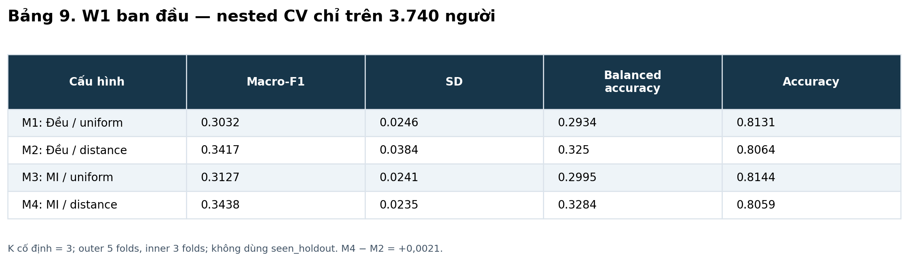

So sánh cần đọc là M3−M1 để đo tác động MI khi phiếu đều, và M4−M2 khi đã dùng distance vote. M4−M2 chỉ **+0,0021**, khoảng mô tả 95% đã lưu là `[-0,0324; 0,0366]`. Khoảng chứa 0, nên **chưa có bằng chứng rõ rằng MI làm tốt hơn feature đều** trong cấu hình nhỏ này.

M1 ở đây đạt `0,3032`, khác `0,3155` CV chọn K của W0 vì khác quy trình fold/đánh giá. Đây không phải hai giá trị thay thế cho cùng một phép đo.

### 8.3. Vì sao W1 ban đầu chưa đủ?

- Cohort train nhỏ, lớp 3 chỉ có 100 người trước outer split.
- Một vector MI chung phải phục vụ hai điều kiện sinh học/đo lường khác nhau.
- K=3 nhạy với lân cận nhỏ; thay trọng số feature chưa khắc phục lệch mật độ lớp.
- Distance vote ưu tiên người gần hơn nhưng chưa bù được bất lợi về số lượng lớp hiếm.

Kết quả này dẫn tới W1 cải thiện: tăng dữ liệu có nhãn thật, tách hai trục và kiểm tra cân bằng phiếu trong các ablation riêng.

## 9. W1 cải thiện: hai trục và balanced voting

### 9.1. Cải thiện về dữ liệu

W1 cải thiện gộp 7.743 người chu kỳ cũ với 5.343 người chu kỳ mới, tạo **13.086 người** sau harmonization. Lớp 3 tăng từ 143 người trong toàn cohort mới lên 379 người trong cohort kết hợp.

Tăng số mẫu tạo điều kiện có thêm hàng xóm lớp hiếm, nhưng **không tự chứng minh mức tăng điểm là do số mẫu**. Muốn định lượng riêng hiệu quả tăng dữ liệu cần thực nghiệm learning curve/giữ cùng evaluation set; dự án hiện chưa cung cấp so sánh đó.

### 9.2. Tách mô hình theo hai trục

Thay vì dự đoán trực tiếp bốn lớp bằng một vector weight, mô hình dùng:

```text
Trục G: y_G = 1 nếu eGFR < 60
        1.072 người dương = lớp 2 + lớp 3

Trục A: y_A = 1 nếu uACR ≥ 30
        1.607 người dương = lớp 1 + lớp 3
```

Hai trục có MI, alpha, K và threshold riêng. Sau khi dự đoán:

```python
G_hat = int(score_G >= threshold_G)
A_hat = int(score_A >= threshold_A)
target_hat = A_hat + 2 * G_hat
```

Ví dụ, eGFR được dự đoán thấp nhưng uACR không cao thì `(G_hat,A_hat)=(1,0)` và `target_hat=2`.

Lý do tách: feature có ích với eGFR thấp chưa chắc có ích tương tự với albumin niệu. Cấu trúc này cho phép mỗi trục học khoảng cách phù hợp hơn, đồng thời bảo toàn định nghĩa target ban đầu.

### 9.3. Balanced distance voting xử lý lệch lớp ra sao?

Trên mỗi trục, với hàng xóm i:

```text
class_factor(c) = N_train / (2 × N_train_class_c)
vote_i = 1 / max(distance_i, 1e-12) × class_factor(y_i)
score = tổng vote của hàng xóm dương / tổng vote mọi hàng xóm
```

Class factor tính từ **nhãn nhị phân của trục đang học**, không lấy trực tiếp bốn tần suất target làm hệ số. Tất cả tần suất chỉ lấy từ train fold. Người thuộc nhãn nhị phân hiếm được tăng sức nặng phiếu, giúp các dấu hiệu hiếm bớt bị số đông lấn át.

Nếu có hàng xóm khoảng cách bằng 0, implementation chỉ giữ phiếu của các hàng xóm trùng đó, rồi áp dụng cân bằng nếu cấu hình có balanced voting. Cách này tránh chia cho 0 và tránh hàng xóm xa làm loãng bản ghi trùng.

Score là **tỷ lệ phiếu đã cân bằng**, chưa phải xác suất nguy cơ đã calibration. Chẳng hạn score=0,7 không có nghĩa người đó có 70% xác suất có dấu hiệu.

### 9.4. Chọn tham số và train

Trong inner CV:

```text
alpha ∈ {0, 0.25, 0.5, 0.75, 1}
K ∈ {3, 5, 7, 11, 15}
threshold ∈ {0.3, 0.4, 0.5, 0.6, 0.7} cho cấu hình balanced
```

W1 balanced chọn tham số bằng **F1 nhị phân riêng cho từng trục**, lấy trung bình qua các inner folds. Sau đó ghép lại để đánh giá target bốn lớp ở outer-test. Đây là điểm W2 sẽ cải thiện: tốt nhất cho hai F1 riêng chưa chắc tốt nhất cho macro-F1 bốn lớp.

Các cấu hình flat chọn theo macro-F1 bốn lớp. Dual không balanced dùng ngưỡng 0,5. Mọi ablation chạy cùng outer splits, đủ 25 evaluations mỗi model.

Tham số artifact W1 cuối theo `reports/combined_w1/results.json`:

| Trục | Alpha | K | Threshold |
|---|---:|---:|---:|
| G: eGFR thấp | 1,0 | 15 | 0,7 |
| A: uACR cao | 1,0 | 15 | 0,6 |

### 9.5. Kết quả W1 và đóng góp từng bước

| Cấu hình trên cohort kết hợp | Macro-F1 mean ± SD | Balanced accuracy | Accuracy | Recall 1 | Recall 2 | Recall 3 |
|---|---:|---:|---:|---:|---:|---:|
| Flat uniform + distance | 0,3337 ± 0,0116 | 0,3184 | 0,8044 | 0,0761 | 0,1186 | 0,1235 |
| Flat MI + distance | 0,3528 ± 0,0165 | 0,3358 | 0,8033 | 0,0757 | 0,1443 | 0,1726 |
| Dual uniform + distance | 0,3364 ± 0,0153 | 0,3187 | 0,8044 | 0,0839 | 0,1302 | 0,1066 |
| Dual MI + distance | 0,3684 ± 0,0151 | 0,3444 | 0,8047 | 0,1070 | 0,1815 | 0,1414 |
| **Dual MI + balanced** | **0,4113 ± 0,0157** | **0,4814** | **0,7258** | **0,2543** | **0,2959** | **0,5626** |
| Dual MI + balanced + missing indicators | 0,4112 ± 0,0137 | 0,4807 | 0,7252 | 0,2591 | 0,2924 | 0,5594 |

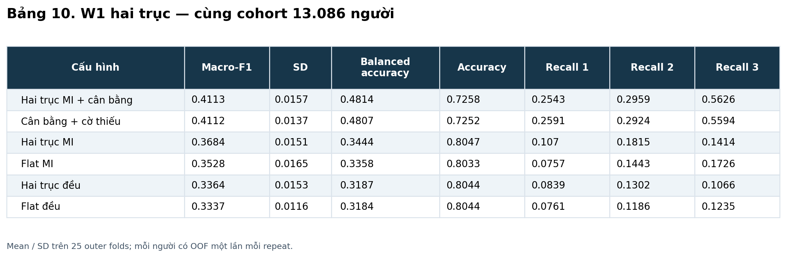

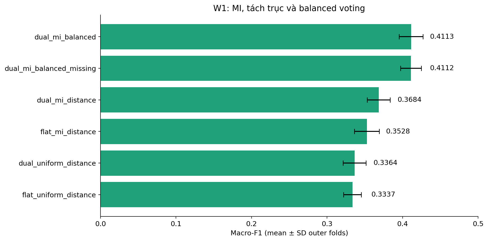

Diễn giải theo từng bước:

| Thay đổi | Mức tăng macro-F1 | Kết luận trong thực nghiệm này |
|---|---:|---|
| Flat uniform → flat MI | +0,0192 | Học weight có tín hiệu tốt hơn trên cohort kết hợp |
| Flat MI → dual MI | +0,0156 | Tách hai trục giúp tăng điểm tổng, dù recall 3 không tăng ở bước này |
| Dual MI → dual MI balanced | +0,0429 | Cân bằng phiếu là thay đổi lớn nhất trong chuỗi này |
| Balanced → thêm missing indicators | −0,0001 | Chưa thấy lợi ích thêm của missing indicators |

Dual MI balanced hơn flat MI **+0,0585 macro-F1**; khoảng mô tả 95% theo năm repeat là `[0,0502; 0,0668]`. Các thay đổi dual so với flat còn bao gồm cách chọn tham số theo trục; không gọi đây là thí nghiệm chứng minh hiệu quả riêng của một feature nào.

### 9.6. Cải thiện đi kèm chi phí nào?

So với flat MI, W1 balanced tăng recall lớp 3 từ `0,1726` lên `0,5626`, nhưng accuracy giảm từ `0,8033` còn `0,7258`. Vì tăng sức nặng phiếu thiểu số, model nhận thêm nhiều người lớp 1–3 nhưng cũng chuyển nhầm nhiều người lớp 0 sang các lớp đó.

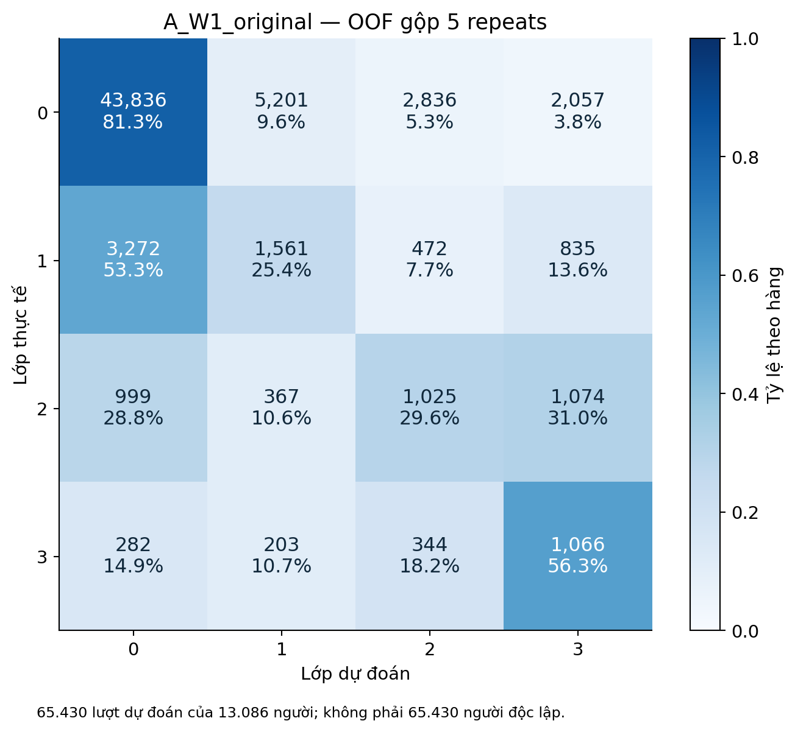

Confusion matrix OOF gộp có **10.094 lượt** lớp 0 bị dự đoán thành 1/2/3. Precision lớp 3 gộp chỉ khoảng `0,2118`: trong những dự đoán lớp 3, khoảng 21% thực sự thuộc lớp 3. Đây là hạn chế quan trọng cần nêu cùng mức tăng recall.

Không nhầm số gộp với trung bình fold: precision lớp 3 mean outer folds của cùng model là `0,2144`; hai cách tính khác nhau nhưng đều cho thấy precision còn thấp.

### 9.7. Trọng số có thay đổi theo trục không?

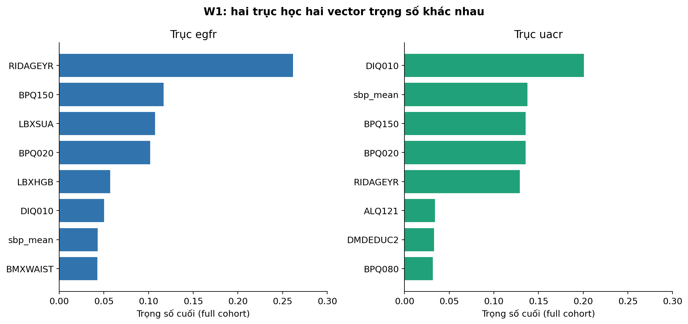

Trong artifact W1 lịch sử:

- Trục eGFR: tuổi `0,2618`, dùng thuốc huyết áp `0,1169`, acid uric `0,1073`, tiền sử tăng huyết áp `0,1020` là những feature đầu bảng.
- Trục uACR: tiền sử đái tháo đường `0,2008`, huyết áp tâm thu `0,1378`, dùng thuốc huyết áp `0,1355`, tiền sử tăng huyết áp `0,1355`, tuổi `0,1290` nổi bật.

Hai vector khác nhau hỗ trợ lý do dùng khoảng cách riêng theo trục. Nhưng các trọng số này đo liên quan phục vụ KNN, không phải ảnh hưởng độc lập sau điều chỉnh hay quan hệ nhân quả. Feature tương quan với nhau cũng có thể chia sẻ thông tin MI.

### 9.8. Kết quả khi chuyển chu kỳ

Train trên 7.743 người chu kỳ cũ, tune chỉ trong dữ liệu cũ, test trên 5.343 người chu kỳ mới:

| Model | Macro-F1 temporal | Accuracy temporal | Recall 3 temporal |
|---|---:|---:|---:|
| Flat MI | 0,3437 | 0,8186 | 0,1608 |
| Dual MI | 0,3510 | 0,8055 | 0,1329 |
| Dual MI balanced | 0,4048 | 0,7084 | 0,5315 |
| Dual balanced + missing indicators | 0,4081 | 0,7163 | 0,4895 |

Xu hướng tăng macro-F1/recall từ balanced voting vẫn xuất hiện khi chuyển chu kỳ, cùng chi phí false positives. Tuy nhiên chu kỳ mới đã được xem trong quá trình nghiên cứu trước đó; temporal validation này không phải external validation hoàn toàn độc lập.

## 10. W2: cải thiện ngưỡng, K/alpha và trọng số nhóm

### 10.1. W2 cần giải quyết điểm yếu nào của W1?

W1 đã tăng recall nhưng tạo nhiều báo động nhầm, trong khi cách chọn tham số vẫn tối ưu F1 nhị phân từng trục. W2 giữ nguyên cohort, 23 feature, hai trục, công thức MI và balanced distance voting, rồi kiểm tra:

1. Chọn **cặp threshold** theo đúng mục tiêu macro-F1 bốn lớp có tốt hơn không?
2. Tăng không gian K/alpha và chọn chúng theo mục tiêu bốn lớp có tốt hơn không?
3. Sau hai bước trên, điều chỉnh sức nặng một số nhóm feature có tăng thêm không?

Đây là chuỗi ablation có kiểm soát. Không gọi toàn bộ mức tăng W2 là hiệu quả của tối ưu trọng số nhóm.

### 10.2. Năm cấu hình A–E được train như thế nào?

| Mã | Tên trong kết quả | Thay đổi so với bước trước | Mục đích |
|---|---|---|---|
| A | `A_W1_original` | Chạy lại thuật toán W1 balanced với lưới gốc | Mốc tham chiếu cùng splits |
| B | `B_joint_thresholds` | Giữ alpha/K của A, chọn cặp ngưỡng theo macro-F1 bốn lớp | Đo tác động chọn ngưỡng phù hợp đầu ra cuối |
| C | `C_joint_K_alpha` | Chọn thêm K/alpha theo macro-F1 bốn lớp, mở rộng K | Đo lợi ích tham số và lân cận lớn hơn |
| D | `D_W2_groups` | Giữ alpha của C, thử hệ số nhóm; tune lại K/ngưỡng | Đo lợi ích nhóm không regularization |
| E | `E_W2_groups_regularized` | Cùng tập ứng viên D, thêm phạt độ lệch hệ số nhóm | Hạn chế thay đổi nhóm quá mạnh so với C |

Tất cả chọn tham số trên inner folds, đánh giá trên cùng 25 outer folds. Các metric được kiểm khi đối chiếu A với W1 đã lưu có sai khác lớn nhất **0,0**, theo `reports/w2/validation.json`: outer kiểm macro-F1, accuracy, balanced accuracy và recall 0–3; temporal kiểm macro-F1, accuracy và balanced accuracy. Vì vậy A là mốc tốt để so sánh W2.

### 10.3. Bước B: chọn hai threshold cùng nhau

Với mỗi cặp ngưỡng `(t_G,t_A)`:

```text
G_hat = score_G ≥ t_G
A_hat = score_A ≥ t_A
y_hat = A_hat + 2 × G_hat
objective = macro-F1 của y_hat so với target bốn lớp
```

B mở rộng ngưỡng thành:

```text
{0.3, 0.4, 0.5, 0.6, 0.7, 0.75, 0.8, 0.85, 0.9, 0.95}
```

Với alpha/K giữ từ A, B duyệt đủ 10×10 cặp threshold trên inner OOF. Ngưỡng cao hơn thường giảm số dự đoán dương, nhờ đó giảm FP, đồng thời có thể tăng FN. Mức tăng B−A bao gồm **cả đổi mục tiêu chọn ngưỡng và mở rộng lưới**, chưa cô lập riêng từng thành phần.

### 10.4. Bước C: mở rộng K và chọn alpha/K theo bốn lớp

```text
K ∈ {3, 5, 7, 11, 15, 21, 31, 51}
alpha ∈ {0, 0.25, 0.5, 0.75, 1}
threshold dùng lưới mở rộng như B
```

K lớn hơn tổng hợp nhiều hàng xóm hơn, có thể giảm nhiễu của lân cận nhỏ, nhưng cũng có thể làm mất cấu trúc cục bộ. Vì vậy K được chọn bằng inner CV, không mặc định K càng lớn càng tốt.

C dùng hai lượt **coordinate search**: giữ tham số một trục, tìm cấu hình trục còn lại làm tốt hơn macro-F1 bốn lớp, rồi đổi trục. Đây là tìm kiếm hữu hạn; không bảo đảm tối ưu toàn cục của mọi cặp alpha/K/ngưỡng.

Mức tăng C−B gồm cả việc đổi cách chọn alpha/K theo đầu ra bốn lớp và mở rộng K. Chưa có ablation tách riêng hai tác động đó.

### 10.5. Bước D/E: tối ưu trọng số theo nhóm

23 feature được chia thành bảy nhóm:

| Nhóm | Feature |
|---|---|
| `age_sex` | RIDAGEYR, RIAGENDR |
| `social` | RIDRETH3, DMDEDUC2, INDFMPIR |
| `body` | BMXBMI, BMXWAIST |
| `blood_pressure` | sbp_mean, dbp_mean, BPQ020, BPQ150 |
| `history` | DIQ010, DIQ160, BPQ080 |
| `lifestyle` | current_smoking, ALQ111, ALQ121, ALQ130, PAD680 |
| `labs` | LBXTC, LBDHDD, LBXSUA, LBXHGB |

Với mỗi trục a, lấy vector nền C rồi nhân hệ số nhóm và chuẩn hóa lại:

```text
base_weight_a,j = (1-alpha_a)/23 + alpha_a × MI_normalized_a,j
weight_a,j = base_weight_a,j × exp(theta_a,group(j))
             / Σ_l [base_weight_a,l × exp(theta_a,group(l))]
```

`theta=0` giữ nguyên nền C. Hệ số dương/âm làm tăng/giảm tương đối trọng số nhóm trước khi chuẩn hóa. Mỗi trục có bộ theta riêng.

Để giới hạn tìm kiếm, mã tạo trước **24 ứng viên thay đổi thưa và một identity**, seed `20261031`, không dựa vào nhãn. Mỗi ứng viên thay đổi 1–4 vị trí trong ma trận 2 trục × 7 nhóm, với hệ số nhân thuộc `{1/2, 2/3, 1, 1.5, 2}`. Đây không phải tối ưu tự do toàn bộ 23 trọng số hoặc tìm kiếm vô hạn.

- **D:** chọn ứng viên làm tốt nhất inner macro-F1, giữ alpha từ C, tune lại K/ngưỡng.
- **E:** cùng các ứng viên, nhưng tối đa hóa `inner_macro_F1 − 0.01 × Σ(theta²)` để ưu tiên ít lệch nền C hơn khi lợi ích nhỏ.

Ở E, tâm regularization là **C** thông qua theta=0, không phải ép trực tiếp toàn bộ feature weights về đều. D/E so với C đo hiệu quả **hệ số nhóm kèm tune lại K/ngưỡng theo quy trình**, không đo một vector cố định hoàn toàn độc lập với lựa chọn tham số.

### 10.6. Kết quả W2 trên cùng 25 outer folds

| Cấu hình | Macro-F1 mean ± SD | Accuracy | Balanced accuracy | Precision 3 | Recall 3 | FP lớp 0 / 1.000 người |
|---|---:|---:|---:|---:|---:|---:|
| A: W1 gốc | 0,4113 ± 0,0157 | 0,7258 | **0,4814** | 0,2144 | **0,5626** | 154,3 |
| B: joint thresholds | 0,4317 ± 0,0194 | 0,7782 | 0,4499 | 0,2939 | 0,4291 | 92,6 |
| C: joint K/alpha | 0,4456 ± 0,0142 | **0,7982** | 0,4503 | 0,3197 | 0,4121 | 71,0 |
| **D: groups** | **0,4462 ± 0,0122** | 0,7955 | 0,4498 | **0,3235** | 0,4106 | 74,3 |
| E: groups regularized | 0,4446 ± 0,0136 | 0,7981 | 0,4475 | 0,3209 | 0,4058 | **70,8** |

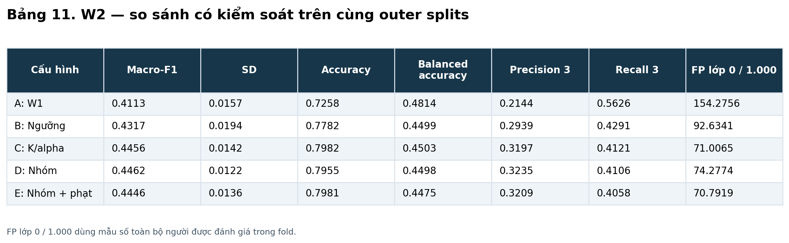

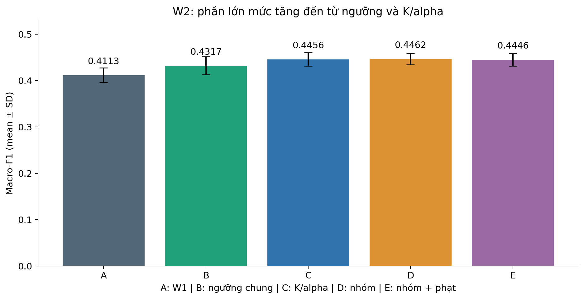

**D có macro-F1 outer trung bình cao nhất**, không phải cao nhất trên mọi metric. W1 A vẫn có balanced accuracy và recall lớp 3 cao hơn; C có accuracy nhỉnh hơn D.

### 10.7. Mỗi bước đóng góp bao nhiêu?

| So sánh | Chênh lệch macro-F1 mean | Khoảng mô tả 95% theo repeat | Diễn giải |
|---|---:|---|---|
| B−A | +0,0204 | [0,0150; 0,0259] | Chọn cặp ngưỡng theo bốn lớp và mở rộng lưới có lợi |
| C−B | +0,0139 | [0,0072; 0,0205] | Chọn alpha/K theo bốn lớp và mở rộng K tăng thêm |
| D−C | +0,0006 | [−0,0045; 0,0058] | Chưa có bằng chứng rõ cho lợi ích bổ sung của nhóm |
| E−C | −0,0010 | [−0,0042; 0,0022] | Regularization nhóm chưa cải thiện điểm trung bình |

D−A = **+0,0349 macro-F1**, tương đương khoảng **3,49 điểm phần trăm** trên thang 0–100. Gần như toàn bộ mức tăng trung bình đã xuất hiện ở bước C. Không nên trình bày kết quả thành “tối ưu trọng số nhóm giúp tăng 3,49 điểm phần trăm”.

Khoảng D−C chứa 0 và mean chỉ +0,0006; không đủ để khẳng định nhóm không regularization tốt hơn C một cách ổn định. Đồng thời không suy rộng thành “mọi cách tối ưu nhóm đều không hiệu quả”: dự án mới kiểm tra một tập nhóm, một tập ứng viên và ngân sách hữu hạn.

### 10.8. W2 được gì và đánh đổi gì so với W1?

So sánh A với D, tất cả dưới đây là **trung bình outer folds**:

| Chỉ số | W1 A | W2 D | Thay đổi |
|---|---:|---:|---:|
| Macro-F1 | 0,4113 | 0,4462 | +0,0349 |
| Accuracy | 0,7258 | 0,7955 | +0,0697 |
| Balanced accuracy | 0,4814 | 0,4498 | **−0,0316** |
| Precision 1 | 0,2169 | 0,2732 | +0,0563 |
| Precision 2 | 0,2176 | 0,3269 | +0,1093 |
| Precision 3 | 0,2144 | 0,3235 | +0,1091 |
| Recall 1 | 0,2543 | 0,2036 | **−0,0507** |
| Recall 2 | 0,2959 | 0,2750 | **−0,0209** |
| Recall 3 | 0,5626 | 0,4106 | **−0,1520** |
| F1 lớp 1 | 0,2303 | 0,2313 | +0,0010 |
| F1 lớp 2 | 0,2492 | 0,2966 | +0,0474 |
| F1 lớp 3 | 0,3090 | 0,3596 | +0,0506 |
| FP từ lớp 0 / 1.000 | 154,3 | 74,3 | **Giảm khoảng 51,9%** |

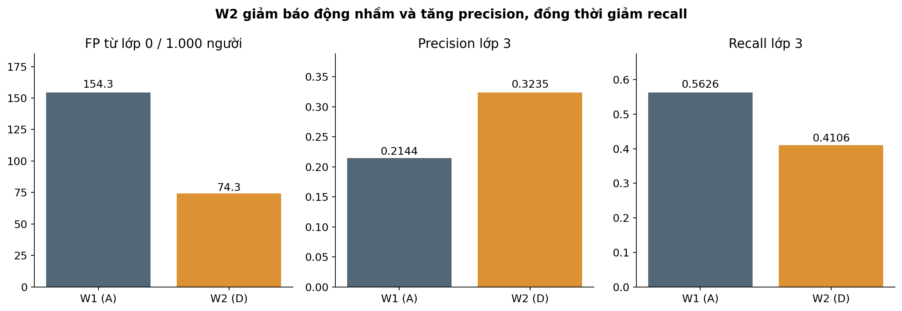

W2 đạt trạng thái **ít báo động nhầm hơn và precision cao hơn**, đổi lại giảm khả năng nhận đúng một phần lớp thiểu số. Macro-F1 vẫn tăng vì F1 cân bằng cả precision/recall, và F1 lớp 0, 2, 3 được cải thiện. Balanced accuracy giảm vì chỉ số này lấy trung bình recall.

Nếu mục tiêu ưu tiên không bỏ sót, W1 có thể phù hợp operating point hơn W2 hiện tại; nếu ưu tiên giảm lượng cần kiểm tra lại, W2 có ưu điểm. Chưa có hàm chi phí thực tế để kết luận một operating point là tối ưu cho ứng dụng.

### 10.9. Confusion matrix W2 cho thấy điều gì?

| True \ Pred | 0 | 1 | 2 | 3 |
|---|---:|---:|---:|---:|
| 0 | 49.070 | 2.807 | 1.344 | 709 |
| 1 | 4.236 | 1.250 | 287 | 367 |
| 2 | 1.644 | 291 | 953 | 577 |
| 3 | 497 | 267 | 353 | 778 |

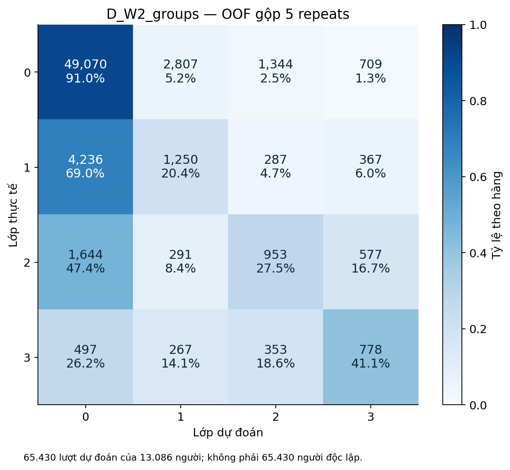

Bảng có 65.430 lượt OOF của 13.086 người qua năm repeat:

- FP từ lớp 0 sang 1/2/3 giảm từ **10.094 xuống 4.860 lượt**.
- Nhận đúng lớp 3 giảm từ **1.066 xuống 778 lượt** trên cùng 1.895 lượt thật lớp 3.
- Theo định nghĩa one-vs-rest của riêng lớp 3: FP giảm từ **3.966 xuống 1.653 lượt**, còn FN tăng từ **829 lên 1.117 lượt**. FP lớp 3 này khác FP “từ lớp 0 sang bất kỳ lớp bất thường” phía trên.
- Precision 3 từ matrix gộp tăng khoảng `0,2118 → 0,3200`, recall 3 giảm `0,5625 → 0,4106`.

Các số tuyệt đối ở đây là **lượt dự đoán lặp**, không phải số người duy nhất phát hiện/bỏ sót. Muốn báo cáo người duy nhất cần định nghĩa thêm cách gộp năm dự đoán của mỗi người; tài liệu không tự tạo quy tắc đó.

### 10.10. Precision–recall: tăng chất lượng score hay chỉ thay ngưỡng?

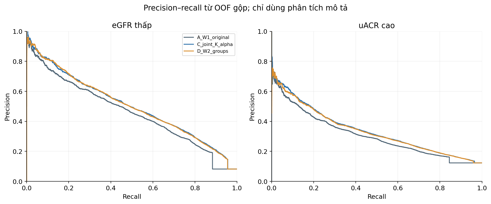

A và B giữ cùng alpha/K/weights nên score và đường PR giống nhau; B chỉ chọn operating point khác. Do đó mức tăng B không có nghĩa chất lượng xếp hạng score đã tốt hơn.

C/D thay khoảng cách và/hoặc K nên có thể thay đổi score ranking. Ví dụ AP trung bình outer folds của A so với D:

| Trục | A: W1 | D: W2 |
|---|---:|---:|
| eGFR thấp | 0,4617 | 0,5050 |
| uACR cao | 0,3102 | 0,3427 |

Phân tích matched-recall sau đánh giá cũng cho thấy ở recall eGFR gộp xấp xỉ W1 `0,6547`, precision tăng từ `0,3614` lên khoảng `0,3961` với C/D. Đây là phân tích mô tả từ OOF, **không dùng threshold hậu nghiệm này làm threshold triển khai**, và không thay thế đánh giá trên dữ liệu mới.

### 10.11. Temporal validation của W2

| Cấu hình | Macro-F1 | Accuracy | Balanced accuracy | Precision 3 | Recall 3 | FP từ lớp 0 (người) |
|---|---:|---:|---:|---:|---:|---:|
| A: W1 | 0,4048 | 0,7084 | 0,4770 | 0,1910 | 0,5315 | 942 |
| B | 0,4335 | 0,8033 | 0,4313 | 0,2949 | 0,3217 | 347 |
| C | **0,4409** | **0,8067** | 0,4272 | **0,3514** | 0,3636 | 322 |
| D | 0,4366 | 0,8065 | 0,4224 | 0,3311 | 0,3427 | **320** |
| E | **0,4409** | **0,8067** | 0,4272 | **0,3514** | 0,3636 | 322 |

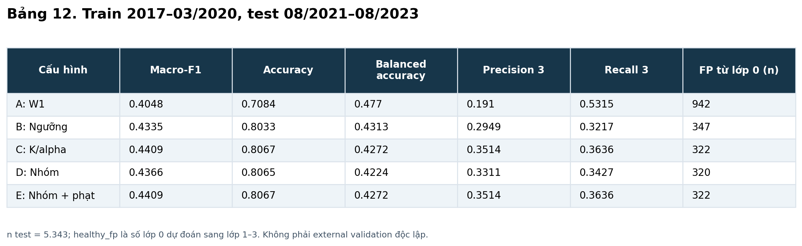

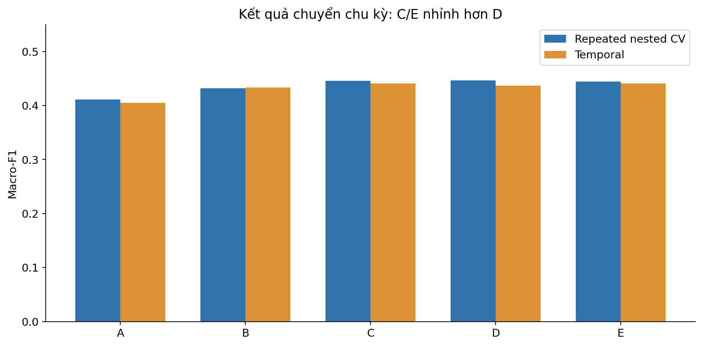

D hơn W1 A **+0,0319 macro-F1 temporal**, đồng thời FP từ lớp 0 giảm từ 942 xuống 320 người. Nhưng **C/E có macro-F1 temporal cao hơn D**, nên D không thắng trên mọi cách đánh giá. Trong temporal run, E chọn identity và trùng cấu hình/dự đoán với C.

Temporal test là 5.343 người riêng của chu kỳ mới, nên số FP trong bảng này là số người test, khác số OOF lặp ở phần trước. Chu kỳ test đã được xem ở các giai đoạn nghiên cứu trước, nên đây vẫn không phải xác nhận external độc lập.

### 10.12. Mô hình W2 cuối có tham số nào?

Theo `reports/w2/final_parameters.json`, sau khi tune/refit trên toàn cohort:

| Cấu hình | Trục G: alpha / K / ngưỡng | Trục A: alpha / K / ngưỡng | Candidate |
|---|---|---|---:|
| A | 1,0 / 15 / 0,7 | 0,5 / 15 / 0,6 | 0 |
| B | 1,0 / 15 / 0,8 | 0,5 / 15 / 0,7 | 0 |
| C | 1,0 / 31 / 0,8 | 0,75 / 51 / 0,7 | 0 |
| **D, model được lưu chọn** | **1,0 / 51 / 0,8** | **0,75 / 51 / 0,7** | **3** |
| E | 1,0 / 51 / 0,8 | 0,75 / 31 / 0,7 | 13 |

Candidate 3 của D nhân nhóm `age_sex` và `labs` lên 2 lần ở trục G, nhóm `social` lên 1,5 lần ở trục A, rồi chuẩn hóa tổng weight về 1. Đây là cấu hình fit toàn cohort, không phải khẳng định mọi outer fold chọn cùng candidate. D thực tế chọn nhiều candidate khác nhau qua folds, thể hiện việc chọn nhóm chưa thật ổn định.

**Lưu ý tái lập:** artifact W1 lịch sử ở phần 9 có alpha uACR=1, còn full-cohort refit A trong W2 có alpha uACR=0,5. W1 lịch sử tune full cohort bằng 5-fold với seed 41000, còn W2 dùng inner=3 với cùng seed 41000; seed MI lúc refit cuối cũng khác nhau. Vì vậy đây không phải hai lần fit cùng một cấu hình CV cuối. Việc A khớp metrics outer/temporal W1 không có nghĩa mọi vector cuối và tham số refit full cohort phải trùng nhau. Khi dùng lại kết quả phải lấy đúng parameters/weights đi cùng artifact của lần chạy đó.

Model `models/nhanes_w2.pkl` lưu cả dữ liệu train, preprocessing, MI, parameters và thứ tự feature. Hàm `nhanes_pipeline.w2.predict(artifact, X)` đòi X đúng 23 feature theo thứ tự artifact; default chọn D. Mã hiện kiểm tra hash source của `w2.py` khi predict, nên sửa module có thể làm artifact cũ từ chối dự đoán. Không sửa model/source chỉ để minh họa tài liệu.

Việc fit model cuối trên cả cohort phục vụ lưu artifact sau đánh giá. Không lấy performance trên chính toàn bộ tập đã fit làm kết quả tổng quát hóa; kết quả báo cáo là outer OOF và temporal đã mô tả.

## 11. Kết luận có thể dùng trong báo cáo

### 11.1. Bảng tổng hợp vai trò từng phiên bản

| Phiên bản | Vấn đề nhắm tới | Cách làm | Điều đã quan sát | Giới hạn chính |
|---|---|---|---|---|
| W0 | Cần baseline rõ ràng | KNN với feature đều, chọn K trên train | Accuracy lịch sử khá cao nhưng recall lớp hiếm rất thấp | Bị lớp 0 chi phối; holdout đã xem |
| W1 ban đầu | Feature đều chưa phản ánh tín hiệu | MI theo feature gốc, shrink về đều | M4−M2 macro-F1 chỉ +0,0021 | Chưa có cải thiện rõ trong cohort train nhỏ |
| W1 hai trục | Một vector chung và lệch lớp | Mở cohort, MI riêng hai trục, balanced voting | So flat MI: macro-F1 +0,0585; recall 3 tăng mạnh | Nhiều FP, precision thiểu số thấp |
| W2 B/C | Ngưỡng/siêu tham số chưa theo đầu ra bốn lớp | Chọn chung threshold; mở K, tune K/alpha theo macro-F1 | Phần lớn mức tăng W2 xuất hiện ở B/C | Recall giảm; chưa có chi phí ứng dụng để chốt operating point |
| W2 D/E | Kiểm tra đóng góp thêm của nhóm feature | Perturbation hữu hạn; có/không phạt theta | D mean cao nhất nhưng D−C chỉ +0,0006; E−C âm nhẹ | Chưa đủ bằng chứng nhóm tạo lợi ích bổ sung ổn định |

### 11.2. Đoạn diễn giải có thể trích vào báo cáo

> Nghiên cứu sử dụng dữ liệu NHANES 2017–March 2020 và August 2021–August 2023 để xây dựng cohort 13.086 người từ 20 tuổi có đủ xét nghiệm tạo nhãn. Target gồm bốn pattern từ hai điều kiện eGFR <60 mL/phút/1,73 m² và uACR ≥30 mg/g. Albumin niệu chu kỳ cũ được đồng nhất về thang phương pháp mới trước khi tạo nhãn; các xét nghiệm trực tiếp tạo nhãn không được đưa vào đầu vào mô hình. Bộ 23 feature được điền khuyết và chuẩn hóa trong từng train fold. Do lớp 0 chiếm 82,42% mẫu, đánh giá tập trung vào macro-F1 và các chỉ số từng lớp.
>
> Trên cohort kết hợp, W1 tách hai trục eGFR/uACR và dùng class-balanced distance voting đạt macro-F1 outer trung bình 0,4113, cao hơn flat MI KNN 0,3528, nhưng tạo nhiều dự đoán dương giả. W2 chọn ngưỡng và siêu tham số theo mục tiêu bốn lớp, đạt macro-F1 cao nhất 0,4462 ở cấu hình D, đồng thời giảm FP từ lớp 0 từ 154,3 xuống 74,3 trên mỗi 1.000 người được đánh giá. Đổi lại, recall lớp 3 giảm từ 0,5626 xuống 0,4106. Phần lớn mức tăng W2 đến từ chọn threshold và K/alpha; lợi ích thêm của trọng số nhóm so với cấu hình C nhỏ và chưa rõ ràng. Kết quả mô tả khả năng phân loại pattern khảo sát, chưa chứng minh hiệu quả chẩn đoán hoặc khả năng triển khai y tế.

### 11.3. Những giới hạn phải giữ trong tài liệu sau này

- Nhãn là phép đo một lần, chưa xác nhận tính mạn tính hoặc dự báo tương lai.
- Người đủ xét nghiệm có thể khác người bị loại; chưa có phân tích đầy đủ selection bias.
- Tuổi/giới tham gia công thức eGFR, nên weight của chúng chịu ảnh hưởng cách định nghĩa nhãn.
- Chưa dùng survey design cho suy luận dân số; class-balanced voting không phải survey weighting.
- MI và hệ số nhóm là liên quan thống kê; không diễn giải nhân quả.
- Scores balanced chưa calibration; precision các lớp thiểu số vẫn còn thấp.
- W2 giảm FP nhưng tăng bỏ sót ở một số lớp; không thể kết luận “cải thiện mọi mặt”.
- Lựa chọn D sau khi so sánh các cấu hình có thể lạc quan; cần dữ liệu chưa tham gia thiết kế để xác nhận.
- Tìm kiếm nhóm hữu hạn, kết quả nhóm chưa ổn định; không khẳng định đã tìm được bộ trọng số tối ưu toàn cục.

### 11.4. Hướng cải thiện tiếp theo — chưa có kết quả trong tài liệu này

1. Dùng cohort/chu kỳ chưa tham gia quá trình thiết kế để đánh giá độc lập.
2. Xác định chi phí FP/FN hoặc mức recall cần giữ trước khi chọn operating point; báo cáo số người cần kiểm tra lại.
3. Kiểm tra calibration trong train/nested CV nếu muốn diễn giải score theo nguy cơ.
4. So sánh với logistic regression, random forest hoặc boosting dưới cùng dữ liệu và protocol.
5. Kiểm tra selection bias, missingness và robust/log preprocessing trong ablation riêng.
6. Phân tích survey-weighted riêng nếu mục tiêu là mô tả dân số, kèm strata/PSU và hướng dẫn gộp chu kỳ phù hợp.

Các mục này là đề xuất nghiên cứu, không phải những bước đã chạy và không được dùng để giải thích điểm hiện có.

## 12. Nguồn, hình và cách tái tạo

### 12.1. Các file nguồn trong dự án

| Nội dung cần đối chiếu | File |
|---|---|
| Tài liệu W1 được yêu cầu phân tích | [CAI_THIEN_W1_NHANES_DUAL_AXIS_2017_2023.md](CAI_THIEN_W1_NHANES_DUAL_AXIS_2017_2023.md) |
| Tài liệu W2 được yêu cầu phân tích | [CAI_THIEN_W2_NHANES_DUAL_AXIS_2017_2023.md](CAI_THIEN_W2_NHANES_DUAL_AXIS_2017_2023.md) |
| Kết quả W0 lịch sử | [baseline_metrics.json](nhanes_w0_handoff/baseline_metrics.json), [cv_m1.csv](nhanes_w0_handoff/cv_m1.csv), [cv_m2.csv](nhanes_w0_handoff/cv_m2.csv) |
| W1 ban đầu, chỉ historical train | [nhanes_ablation.csv](reports/w1/nhanes_ablation.csv), [REPORT.md](reports/w1/REPORT.md) |
| Manifest cohort kết hợp | [nhanes_combined_manifest.json](data/processed/nhanes_combined_manifest.json) |
| Dữ liệu kết hợp | [nhanes_combined_2017_2023.csv](data/processed/nhanes_combined_2017_2023.csv) |
| W1 hai trục | [model_summary.csv](reports/combined_w1/model_summary.csv), [results.json](reports/combined_w1/results.json), [weights](reports/combined_w1/final_axis_weights.csv) |
| W2, protocol và kiểm chứng | [protocol.json](reports/w2/protocol.json), [validation.json](reports/w2/validation.json) |
| W2, kết quả và tham số | [summary.csv](reports/w2/summary.csv), [final_parameters.json](reports/w2/final_parameters.json) |
| W2, dự đoán và gộp OOF | [oof_predictions.csv](reports/w2/oof_predictions.csv), [pooled_oof_metrics.csv](reports/w2/pooled_oof_metrics.csv) |
| W2, chuyển chu kỳ | [temporal.csv](reports/w2/temporal.csv), [temporal_predictions.csv](reports/w2/temporal_predictions.csv) |
| Quy tắc làm sạch chu kỳ mới | [builder.py](src/nhanes_pipeline/builder.py) |
| Harmonization và cohort kết hợp | [combined_builder.py](src/nhanes_pipeline/combined_builder.py) |
| Preprocessing, MI, balanced voting W1 | [combined_experiment.py](src/nhanes_pipeline/combined_experiment.py) |
| Tìm kiếm A–E và predict W2 | [w2.py](src/nhanes_pipeline/w2.py) |

Số liệu W0 được kiểm lại từ confusion matrix; nhãn và missingness được kiểm trực tiếp từ CSV; ảnh W1/W2 lấy đúng các bảng kết quả và OOF đã lưu. Đối với dữ liệu thô chu kỳ cũ, manifest có checksum nhưng thư mục tạm `/tmp/nhanes_2017_2020` hiện không tồn tại trong workspace; cần tải lại file gốc đúng nguồn/hash nếu muốn build lại toàn bộ cohort từ đầu.

### 12.2. Thư mục ảnh và bảng để dùng lại

Tất cả ảnh nằm ở **`khai_pha_du_lieu/anh/`**, hiểu `/anh` theo thư mục con của dự án. Danh mục đầy đủ: [`anh/README.md`](anh/README.md).

- `01–09`: rule target, cohort, phân bố lớp, schema, missingness, ví dụ dòng thật và làm sạch.
- `10–12`: bảng kết quả và confusion matrix W0/M2.
- `13–15`: W1 ban đầu và W1 hai trục.
- `16–20`: W2 A–E, đánh đổi và confusion matrix W1/W2.
- `21–24`: temporal validation, trọng số hai trục và precision–recall.

Mỗi hình có `.png` để chèn Word/PowerPoint và `.svg` để chỉnh hoặc in rõ. Bảng và confusion matrix có thêm `.csv` để sao chép số liệu; số thực trong CSV ảnh bảng được làm tròn cho trình bày. Khi cần tính lại chính xác dùng CSV nguồn ở `reports/`.

File [`anh/so_lieu_tai_lieu.json`](anh/so_lieu_tai_lieu.json) lưu thống kê kiểm tra, phiên bản môi trường vẽ và hash dữ liệu nguồn. PNG/SVG là hình dựng bằng Matplotlib từ số liệu, không dùng ảnh sinh bởi AI để biểu diễn kết quả nghiên cứu.

### 12.3. Tái tạo ảnh từ số liệu đã có

Từ thư mục `khai_pha_du_lieu`:

```bash
python3 scripts/11_export_documentation_figures.py
```

Script cần `numpy`, `pandas`, `matplotlib`; không train model, không thay CSV nguồn và không sửa báo cáo W1/W2 cũ. Script kiểm số dòng, khóa duy nhất, rule target, nguồn nhãn và OOF trước khi xuất hình/bảng. Môi trường vẽ hiện tại được ghi trong JSON thay vì giả định trùng môi trường train.

Các lệnh train lịch sử có sẵn để tham khảo khi cần chạy lại, **không cần chạy chỉ để lấy ảnh**:

```bash
python3 scripts/02_train_w1.py
python3 scripts/04_train_combined_w1.py
python3 scripts/07_train_w2.py --repeats 5 --outer 5 --inner 3 --jobs 1
```

W1 ban đầu và W1 hai trục từng được báo cáo trong Docker theo dependencies riêng; W2 lưu môi trường thực tế Python 3.12.3, NumPy 1.26.4, SciPy 1.11.4 trong protocol. File `requirements.txt` của dự án pin NumPy 2.1.3/SciPy 1.14.1, nên không khẳng định cài requirements đó sẽ tái lập từng bit kết quả W2. Khi chạy lại cần đối chiếu protocol, source/data hash, môi trường và checkpoint.

### 12.4. Nguồn chính thức hỗ trợ công thức và rule

- [CDC NHANES ALB_CR_L](https://wwwn.cdc.gov/Nchs/Data/Nhanes/Public/2021/DataFiles/ALB_CR_L.htm): đơn vị albumin/creatinine niệu, đổi phương pháp xét nghiệm và phương trình bridge.
- [NIDDK: eGFR Equations for Adults](https://www.niddk.nih.gov/research-funding/research-programs/kidney-clinical-research-epidemiology/laboratory/glomerular-filtration-rate-equations/adults): phương trình CKD-EPI creatinine 2021 và giới hạn ước lượng.
- [CDC: Testing for Chronic Kidney Disease](https://www.cdc.gov/kidney-disease/testing/index.html): diễn giải các ngưỡng xét nghiệm và việc có thể cần đo lặp lại.
- [CDC: CKD in the United States, 2026](https://www.cdc.gov/kidney-disease/media/pdfs/CKD-Factsheet-H.pdf): giới hạn khi chỉ có phép đo albumin/creatinine một lần.

Các nguồn chính thức hỗ trợ định nghĩa đo lường. Các mức điểm và mức tăng W0/W1/W2 trong tài liệu này là **kết quả riêng của dự án**, không phải hiệu quả mô hình do CDC/NIDDK công bố.
